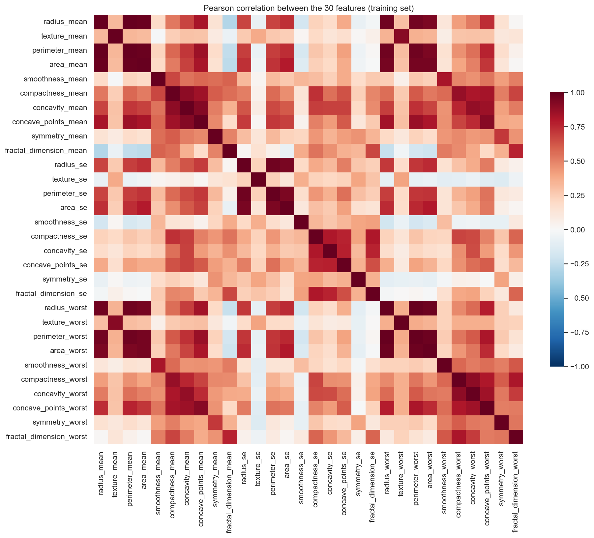
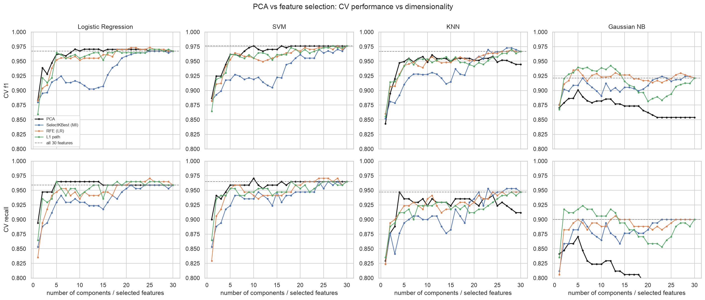
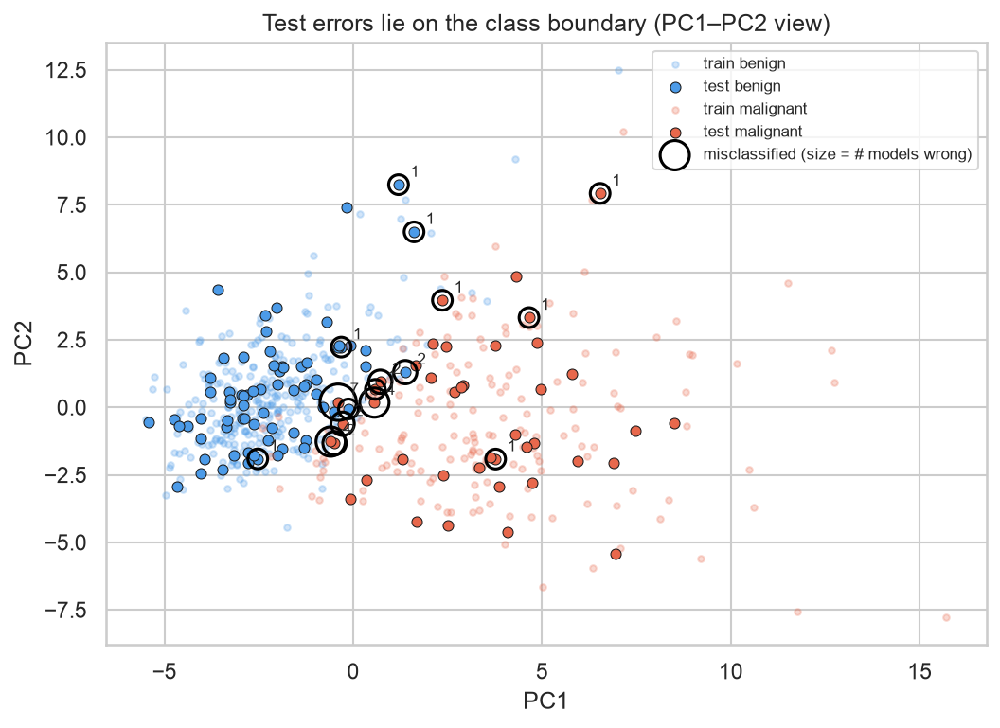

# Breast Tumor Classification Using Classical Machine Learning: PCA and Feature Selection

**Group:** Rohan Agrawal (2024ADPS0004G), Srinivasa Harshith Pataneni (2024A7PS0597G),
Malay Neema (2024A1PS0286G), Nandika Tamse (2024A1PS1463G), Priyanshi Modi (2023B3A70791G),
Avisha Srivastava (2024A1PS0273G)

All numbers below come from the executed notebooks in `notebooks/`. The CSV files in
`results/` and the figures in `figures/` are the source data.

---

## 1. Problem and data

We classify breast tumours as **benign or malignant** using the UCI Breast Cancer Wisconsin
(Diagnostic) dataset: 569 fine-needle-aspirate samples with 30 numeric features. The
features are the mean, standard error and "worst" value of 10 nucleus measurements: radius,
texture, perimeter, area, smoothness, compactness, concavity, concave points, symmetry and
fractal dimension. We compare eight classical classifiers on all 30 features, and we test
whether **PCA** (dimensionality reduction) or **feature selection** can match them with far
fewer inputs.

**Data quality (nb 01).** No missing values, no duplicate records, valid labels only. The
`id` column was dropped. Thirteen samples have exact zeros in the concavity and
concave-points features; these are genuine values (no concavities), not missing data.
The classes are 357 benign (62.7 %) and 212 malignant (37.3 %).

**Key EDA findings (training set only).**
* Feature scales differ by up to six orders of magnitude, and many features are strongly
  right-skewed (`area_se` skew 5.5). Scale-sensitive models therefore need standardisation.
* Size features (radius, perimeter, area) and concavity features separate the classes
  best. The best single feature, `perimeter_worst`, has a univariate AUC of 0.974. Smoothness,
  symmetry and fractal dimension are weak on their own.
* **Heavy multicollinearity:** 21 of the 435 feature pairs have |r| > 0.9. For example,
  radius_mean vs perimeter_mean has r = 0.998. The 30 features contain far fewer than 30
  independent dimensions.



## 2. Experimental protocol (identical for all members, `src/common.py`)

| Item | Choice |
|---|---|
| Positive class | malignant = 1 |
| Split | one stratified 80/20 train/test split, `random_state = 42` → 455 train / 114 test (42 malignant) |
| Model development | 5-fold stratified CV on the training set (`random_state = 42`) |
| Tuning criterion | malignant-class F1 (balances missed cancers against false alarms) |
| Metrics | accuracy, precision, malignant recall (sensitivity), specificity, F1, ROC-AUC, confusion matrix |
| Leakage control | `StandardScaler`, PCA and every feature selector are steps inside an sklearn `Pipeline`, so they are re-fitted on each training fold only |
| Coordination | tuned hyper-parameters are saved to `results/best_params.json` and reused by the PCA and feature-selection experiments (with re-tuning sanity checks) |
| Test set | touched once, in notebook 07, after all selection and tuning was finished |

## 3. Classical models on all 30 features (nb 01–04)

| Model | Tuned hyper-parameters | CV accuracy | CV recall | CV specificity | CV F1 | CV ROC-AUC |
|---|---|---|---|---|---|---|
| Majority baseline | – | 0.626 | 0.000 | 1.000 | 0.000 | 0.500 |
| LDA | default | 0.956 ± 0.023 | 0.888 ± 0.060 | 0.996 | 0.937 ± 0.034 | 0.994 |
| Logistic Regression | L2, C = 0.1, balanced | 0.976 ± 0.008 | 0.959 ± 0.014 | 0.986 | 0.967 ± 0.011 | 0.995 |
| Gaussian NB | var_smoothing = 0.03 | 0.943 ± 0.027 | 0.900 ± 0.051 | 0.968 | 0.921 ± 0.037 | 0.987 |
| KNN | k = 3, Manhattan, uniform | 0.976 ± 0.016 | 0.947 ± 0.034 | 0.993 | 0.967 ± 0.022 | 0.983 |
| **SVM** | **RBF, C = 3.16, γ = 0.01, balanced** | **0.982 ± 0.011** | **0.965 ± 0.034** | 0.993 | **0.976 ± 0.016** | **0.995** |
| Decision Tree | gini, depth 5, min_leaf 5, balanced | 0.954 ± 0.022 | 0.929 ± 0.040 | 0.968 | 0.938 ± 0.030 | 0.975 |
| Random Forest | 200 trees, max_features 0.5, min_leaf 2 | 0.969 ± 0.019 | 0.953 ± 0.035 | 0.979 | 0.959 ± 0.025 | 0.985 |

Observations:
* The **majority baseline** shows why accuracy alone is misleading: it scores 63 % accuracy
  but detects **no** cancers.
* **LDA** is a strong linear reference with almost no false positives, but it misses about 11 %
  of malignant tumours.
* The **RBF SVM** is the best model, and **Logistic Regression** and **KNN** follow closely.
  Without scaling, KNN's F1 drops from 0.951 to 0.909, which demonstrates the need for
  standardisation.
* **Gaussian NB** is weakest among the probabilistic and linear models. Its Gaussian,
  conditionally independent model fits the skewed, correlated features poorly.
* A single **Decision Tree** overfits easily: training accuracy reaches 100 % while CV
  stays at about 93–95 %. The **Random Forest** fixes most of this, but at the cost of
  interpretability.

## 4. PCA (nb 05)

The first principal component explains 44.6 % of the variance, two components 63.1 %, five
84.9 %, and **ten components 95.2 %**. So the 95 % rule selects exactly 10 components.
PC1 is an overall "large, irregular nucleus" axis that loads on concavity, concave points,
compactness and size. In the PC1–PC2 plane the classes are already almost linearly
separable, even though PCA never saw the labels.

| Model (reused params) | all 30 | PCA 2 | PCA 5 | PCA 10 (= 95 %) |
|---|---|---|---|---|
| Logistic Regression — CV F1 | 0.967 | 0.939 | 0.962 | **0.968** |
| SVM — CV F1 | 0.976 | 0.925 | 0.962 | **0.976** |
| SVM — CV malignant recall | 0.965 | 0.941 | 0.959 | **0.971** |
| KNN — CV F1 | 0.967 | 0.895 | 0.949 | 0.949 |
| Gaussian NB — CV F1 | 0.921 | 0.879 | 0.901 | 0.882 |

* With **10 components (one third of the dimensions)**, LR and SVM match their 30-feature
  performance, and SVM recall even rises slightly. The minimum number of components within
  0.01 F1 of the full model is 5 for LR, 8 for SVM and 9 for KNN.
* With two components, every model loses 3–7 F1 points.
* **PCA hurts Gaussian NB.** Decorrelated components are not class-conditionally
  independent, and the low-variance components it keeps add noise.
* **Re-tuning** the classifiers inside each PCA setting changes little (≤ 0.01 F1), except
  for KNN. With re-tuned *k*, KNN on 5 components recovers its 30-feature score.
* PCA does not clearly improve accuracy here. Its value is compression. The cost is that
  every component mixes all 30 measurements, so all 30 still have to be measured and the
  model cannot be explained in clinical terms.

## 5. Feature selection (nb 06)

Three selectors were asked for k = 5, 10 and 15 features, inside the CV pipeline:
**SelectKBest with mutual information** (filter), **RFE with logistic regression** (wrapper)
and an **L1-regularisation path** (embedded). The L1 path keeps the first *k* features to
enter an L1 logistic regression as C grows.

| CV F1 (reused params) | all 30 | MI 5 | MI 10 | MI 15 | RFE 5 | RFE 10 | RFE 15 | L1 5 | L1 10 | L1 15 |
|---|---|---|---|---|---|---|---|---|---|---|
| Logistic Regression | 0.967 | 0.919 | 0.913 | 0.907 | 0.952 | 0.952 | 0.961 | **0.965** | 0.955 | 0.952 |
| SVM | 0.976 | 0.918 | 0.919 | 0.923 | 0.953 | 0.955 | 0.958 | 0.961 | 0.956 | 0.961 |
| KNN | 0.967 | 0.910 | 0.928 | 0.915 | 0.943 | 0.952 | 0.948 | 0.942 | 0.954 | 0.951 |
| Gaussian NB | 0.921 | 0.909 | 0.891 | 0.905 | 0.936 | 0.923 | 0.927 | **0.940** | 0.939 | 0.916 |

* **Univariate MI filtering fails on correlated data.** Its top features are largely
  redundant copies of tumour size (radius, perimeter and area in `_mean` and `_worst`
  versions), so it stays 4–6 F1 points below the full set even with 15 features. It is
  perfectly *stable* across folds, but stable is not the same as useful.
* **Multivariate selection works.** **Five L1-path features** (`radius_worst`,
  `perimeter_worst`, `concave_points_worst`, `concave_points_mean`, `texture_worst`) give
  logistic regression CV F1 0.965 and recall 0.965, compared with 0.967 and 0.959 on all
  30 features.
* **Re-tuning matters more than for PCA.** It recovers up to 1.5 F1 points. With 10 L1
  features, LR reaches 0.970 and a linear SVM 0.971, essentially equal to the full models.
* **Gaussian NB improves** with selection (0.921 → 0.940), because whole groups of redundant
  features are removed.
* **L1 for classification vs L1 for selection.** The L1-penalised LR, which uses about 9
  features, scores F1 0.964. Using the L1 path to select 9 features for a separate LR or
  SVM scores 0.961. The one-step L1 classifier is simpler and just as good.

**Consistently important measurements.** The same features come out on top across the
three selectors, the CV folds, the tree importances (nb 04), the LR coefficients and the
PC1 loadings: `radius_worst`, `perimeter_worst`, `area_worst`, `concave_points_worst` and
`concave_points_mean`, then `texture_worst` and `radius_se`. In short, the **size and
concavity of the most abnormal nuclei**, plus texture as the main non-redundant extra
signal.

## 6. PCA vs feature selection



* At equal dimensionality, **PCA is equal or better for LR and SVM**. The gap is largest
  at 2–4 dimensions and, for SVM, at 8–15, because each component pools information from
  all 30 features.
* For KNN, PCA and selection are similar. For Gaussian NB, selection is much better.
* Feature selection yields a short list of **named measurements**. Only those need to be
  collected, and a linear model on them can be read directly. For linear models it is as
  accurate as PCA with 5–10 features.

## 7. Final evaluation on the held-out test set (nb 07)

Each model was refitted on all 455 training samples and scored once on the 114 test samples.

| Model (30 features) | Test accuracy | Precision | Recall | Specificity | F1 | ROC-AUC | FN | FP |
|---|---|---|---|---|---|---|---|---|
| Majority baseline | 0.632 | 0.000 | 0.000 | 1.000 | 0.000 | 0.500 | 42 | 0 |
| LDA | 0.965 | 1.000 | 0.905 | 1.000 | 0.950 | 0.997 | 4 | 0 |
| **Logistic Regression** | **0.991** | 1.000 | **0.976** | 1.000 | **0.988** | 0.998 | **1** | 0 |
| Gaussian NB | 0.921 | 0.923 | 0.857 | 0.958 | 0.889 | 0.990 | 6 | 3 |
| KNN | 0.965 | 1.000 | 0.905 | 1.000 | 0.950 | 0.974 | 4 | 0 |
| **SVM (RBF)** | **0.991** | 1.000 | **0.976** | 1.000 | **0.988** | 0.997 | **1** | 0 |
| Decision Tree | 0.904 | 0.897 | 0.833 | 0.944 | 0.864 | 0.908 | 7 | 4 |
| Random Forest | 0.974 | 1.000 | 0.929 | 1.000 | 0.963 | 0.993 | 3 | 0 |

The test ranking matches the CV ranking. Selected reduced models on the test set (all reduced results are in `results/test_reduced.csv`):

| Model | Features | Test accuracy | Recall | FN | FP |
|---|---|---|---|---|---|
| SVM + PCA 10 | 10 PCs | 0.982 | 0.952 | 2 | 0 |
| LR + PCA 10 | 10 PCs | 0.982 | 0.952 | 2 | 0 |
| LR / SVM + PCA 2 | 2 PCs | 0.982 | 0.976 | 1 | 1 |
| LR + L1 path 5 | 5 measurements | 0.965 | 0.952 | 2 | 2 |
| LR + L1 path 10 | 10 measurements | 0.982 | 0.952 | 2 | 0 |
| SVM + L1 path 10 | 10 measurements | 0.982 | 0.952 | 2 | 0 |

The 2-component models do as well on the test set as the 10-component ones, even though CV
puts them 3–5 F1 points lower. This is a reminder that a 114-sample test set cannot separate
models that differ by one or two errors. Models were therefore ranked on CV, never on the
test set.

**Final model selection.** The rule was declared before testing: highest CV F1, with ties
within 0.002 broken in favour of fewer features. It picks **RBF SVM on 10 principal
components** (CV F1 0.976, CV recall 0.971). On the test set it scores 98.2 % accuracy,
recall 0.952, specificity 1.000 and ROC-AUC 0.998. The bootstrap 95 % CI for test recall is
[0.875, 1.0].

**How much can we trust the small differences?** With 42 malignant test cases, one missed
cancer moves recall by 2.4 points. **Repeated 10 × 5-fold CV** of the top eight
configurations gives F1 0.958–0.967 with a fold standard deviation of 0.020–0.027. LR on all
30 features, LR on 10 PCs, SVM on 10 PCs and SVM on all 30 are all within 0.002 F1 of each
other, so they are **statistically indistinguishable**. Even LR on five selected features
is only about 0.008 behind.

**Prioritising malignant recall.** For the final model we moved the decision threshold so
that out-of-fold training recall is ≥ 0.99. The threshold was chosen on training data only.
On the test set this gives **recall 1.000 (no missed cancers)**, at the cost of 8 false
positives (specificity 0.889, accuracy 0.930). For a screening tool this trade is usually
worthwhile, and it changes malignant detection far more than the choice of classifier does.

**Error analysis.** 17 test tumours are misclassified by at least one model, and only 3 by
four or more. One malignant tumour (moderate size, `radius_worst` 16.6, low texture) is
missed by all seven models. All the shared errors lie on the class boundary in the PC1–PC2
plane. They are borderline, medium-sized tumours, not labelling mistakes or outliers.



## 8. Answers to the research questions

1. **Best classifier on 30 features:** RBF SVM (CV F1 0.976), statistically tied with Logistic
   Regression. Both make one error on the test set (98 – 99 % accuracy, 100 % specificity).
2. **Does PCA help?** It neither helps nor hurts at 10 components, which keep 95 % of the
   variance. It hurts at 2 components, and it hurts Gaussian NB.
3. **How many components?** 5 for LR, 8–10 for SVM and KNN.
4. **Feature selection with far fewer features?** Yes, with RFE or the L1 path. Five L1
   features are enough for LR, and ten re-tuned features reach about 0.97 F1 for LR and SVM.
   The univariate MI filter does not get there.
5. **Consistently important measurements:** worst radius, perimeter and area, worst and mean
   concave points, then worst texture and radius SE.
6. **PCA vs selection:** PCA is slightly more accurate at very low dimension for the
   linear models and the SVM. Selection is just as accurate for linear models at 5–10
   features, needs fewer measurements, and stays interpretable.
7. **Trade-off:** accuracy is close to saturated on this dataset, so the real decision is
   about interpretability and measurement cost. Our **practical recommendation is logistic
   regression on about 5–10 L1-selected features**. It reaches 96.5–97 % CV F1 with a short,
   auditable list of weights, against at most about 0.01 F1 for the black-box SVM + PCA. The
   decision threshold should be set for high sensitivity.

## 9. Significant computation part: from-scratch implementations and heavy experiments (nb 08)

The project's significant computation part is one separate notebook, presented as a whole by
Member 5.
Every algorithm used in the project was implemented from scratch in NumPy (`src/scratch.py`,
about 600 lines), checked against scikit-learn, and then used in over 15,000 extra model fits
(nested cross-validation and a permutation test). The notebook takes about 10 minutes to run,
while most of the others take seconds.

**Why it was done.** Notebooks 01–07 rely on scikit-learn, which hides the mathematics.
Implementing each algorithm by hand shows exactly how it works, and matching scikit-learn's
output verifies both the mathematics and the code. The heavy experiments check that the
reported scores are honest (not inflated by tuning) and reflect a real signal (not chance).

The classes follow the scikit-learn API, so they run through the same pipelines, folds and
metrics as everything else.

| Implemented | Key computational idea |
|---|---|
| standardisation, stratified K-fold | per-class shuffling, round-robin fold assignment |
| logistic regression, Gaussian NB | accelerated (Nesterov) gradient descent with step 1/L; log-sum-exp |
| KNN, kernel SVM | distance matrix as one matrix product + `argpartition`; **SMO dual solver** with LIBSVM's second-order working-set selection |
| CART tree, Random Forest | sort-once/cumulative-sum split search, O(d·n log n) per node; bagging with out-of-bag score |
| PCA | covariance eigendecomposition; hand-written power iteration with deflation |
| RFE | recursive elimination driven by the hand-written logistic regression |

**Correctness against scikit-learn** (tuned hyper-parameters, same 5 folds):

| Model | CV F1, scratch | CV F1, sklearn | Test predictions identical |
|---|---|---|---|
| Logistic Regression | 0.9671 | 0.9671 | 100 % |
| Gaussian NB | 0.9214 | 0.9214 | 100 % |
| KNN | 0.9667 | 0.9667 | 100 % |
| SVM (RBF) | 0.9760 | 0.9760 | 100 % (same 73 support vectors) |
| Decision Tree | 0.9274 | 0.9378 | 99.1 % |
| Random Forest | 0.9519 | 0.9587 | 100 % |

The deterministic models match to numerical precision: LR coefficients within 2e-6, GNB and
KNN probabilities within 1e-14, and PCA components within 6e-15 (eigh) or 5e-6 (power
iteration). Scratch RFE keeps exactly the same 5 features as scikit-learn. The trees differ
only by tie-breaking between equally good splits, and the gap is well inside the CV standard
deviation (about 0.03).

**Convergence and complexity.** Gradient descent converges in 1,545 iterations. SMO reaches
a KKT gap of 1e-3 in 176 iterations. Power iteration needs 18–123 iterations per component,
and slower when the eigengap ratio λ(k+1)/λ(k) is close to 1. The scratch Random Forest's OOB
accuracy is 0.960 (scikit-learn 0.956). Runtime is within 2–4× of scikit-learn, except
logistic regression (about 20×, because first-order gradient descent needs many more
iterations than scikit-learn's curvature-aware solver).

**Nested cross-validation** (5 outer × 5 inner folds; about 4,600 fits for the SVM grid, over 10,000 for the four models):

| Model | Best grid CV F1 (used so far) | Nested CV F1 | Optimism |
|---|---|---|---|
| Logistic Regression | 0.967 | 0.955 ± 0.017 | 0.013 |
| KNN | 0.967 | 0.945 ± 0.032 | 0.021 |
| SVM (RBF) | 0.976 | 0.955 ± 0.019 | 0.021 |
| Random Forest | 0.959 | 0.937 ± 0.040 | 0.022 |

Picking the best of many grid candidates overstates performance by about 0.01–0.02 F1. The
ranking does not change: SVM ≈ LR > KNN > RF.

**Permutation test** (from-scratch LR pipeline, 1,000 label shuffles × 5 folds = 5,000 fits):
real CV F1 0.967 vs 0.416 ± 0.036 with shuffled labels (maximum 0.517), so p = 0.001, the
minimum possible with 1,000 permutations.

## 10. Limitations

* The dataset is small (569 samples, 114 for testing) and comes from a single source, so
  differences of one or two test errors are not meaningful. Results may not transfer to
  other hospitals or imaging set-ups.
* The PCA and feature-selection experiments reuse hyper-parameters tuned on 30 features,
  as the proposal specified. Re-tuning checks show this slightly understates feature
  selection and PCA for KNN.
* The high-sensitivity threshold was fixed at recall ≥ 0.99. A real deployment would set it
  from clinical costs.

## 11. Reproducing

```bash
pip install -r requirements.txt
python src/build_notebooks.py        # rebuilds and executes notebooks 01–08 (~20 min)
```
